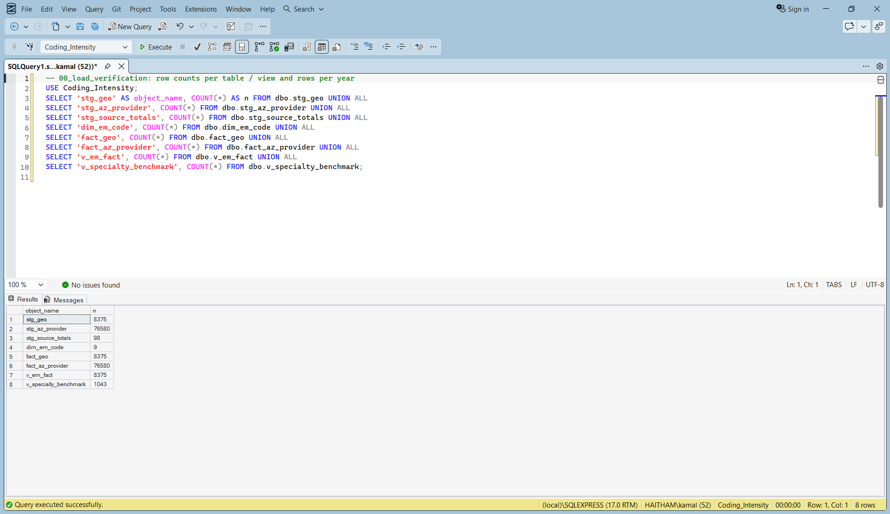
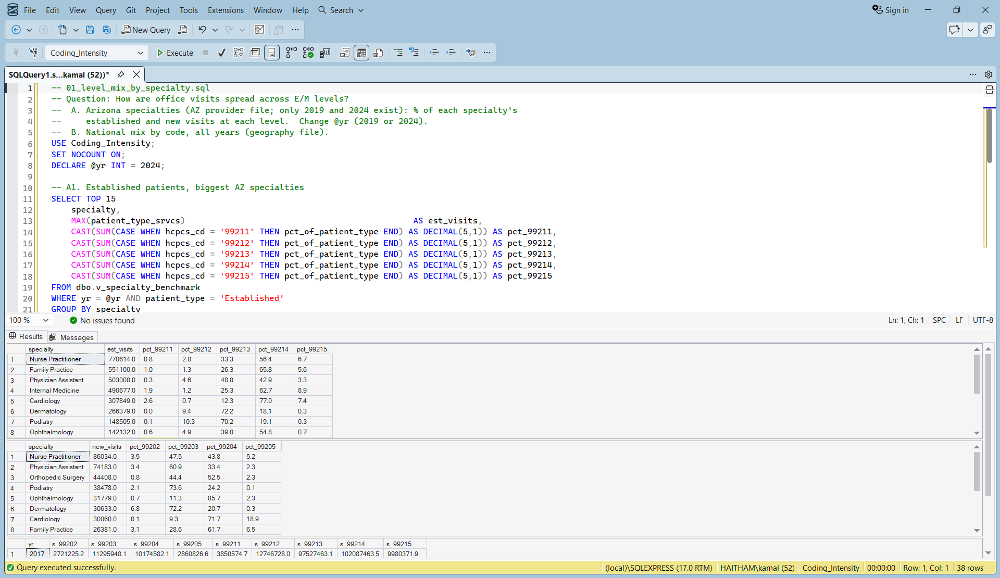
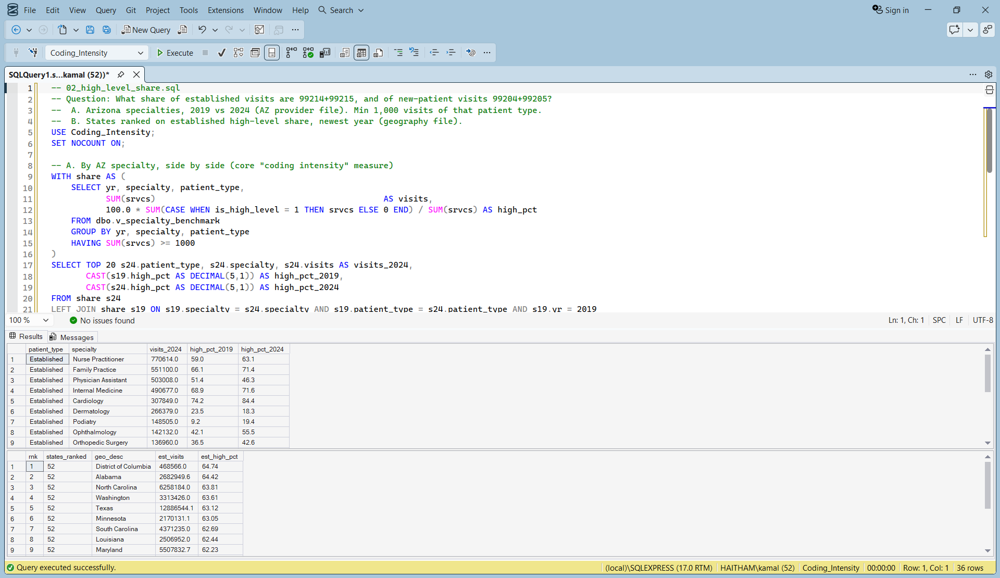
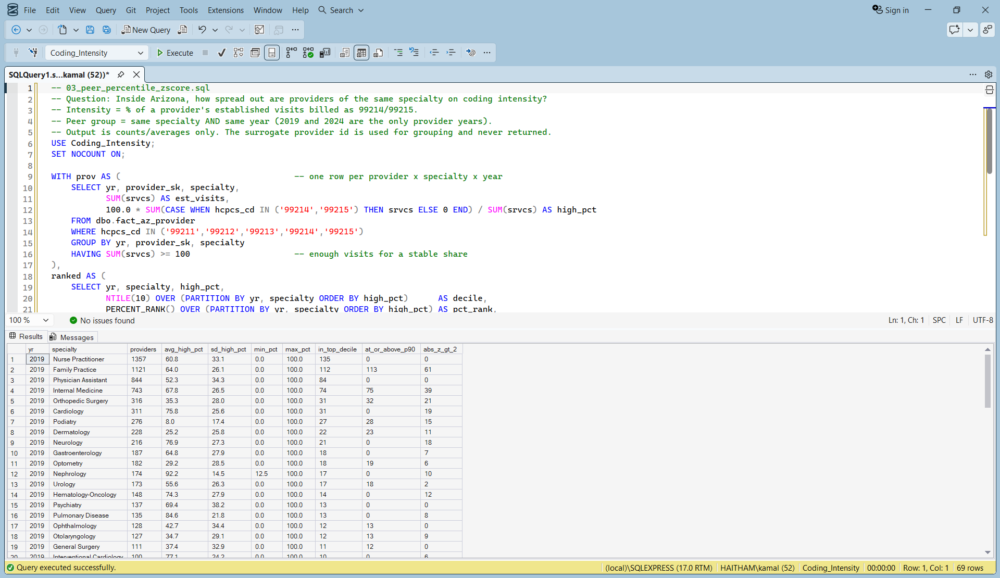
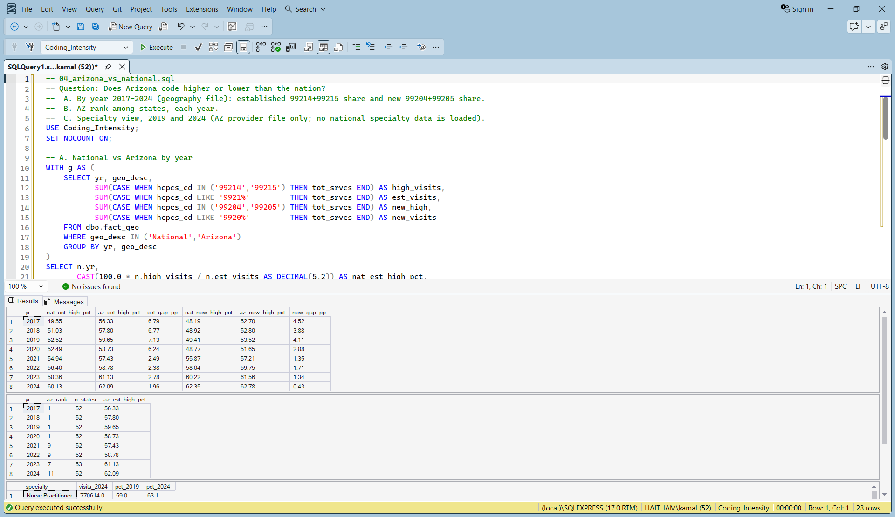
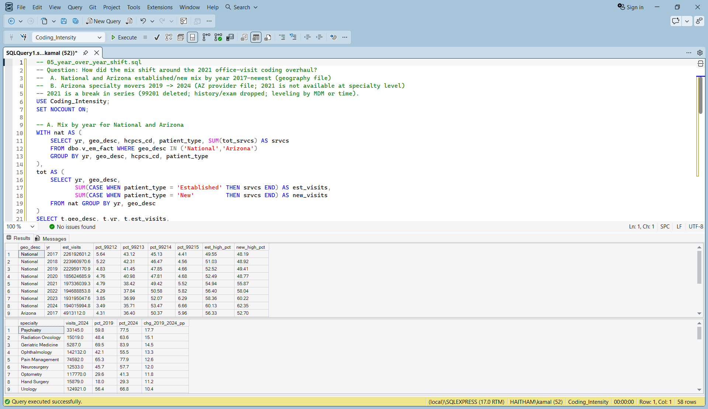
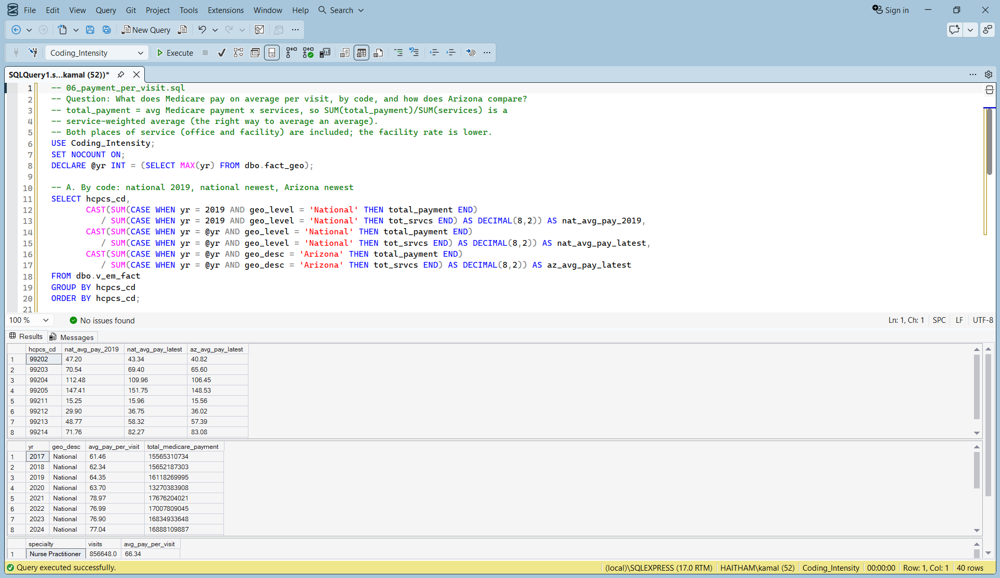
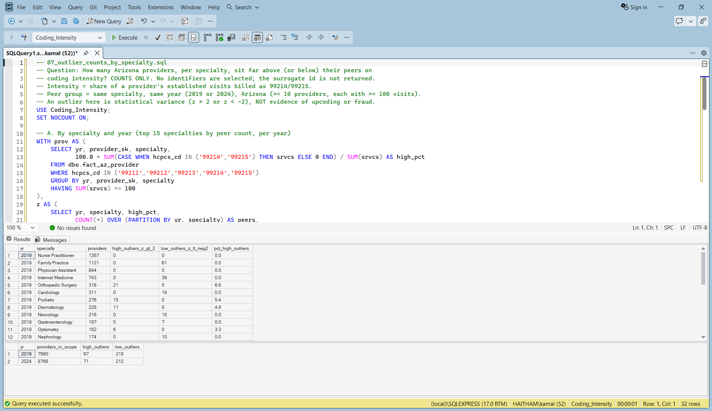
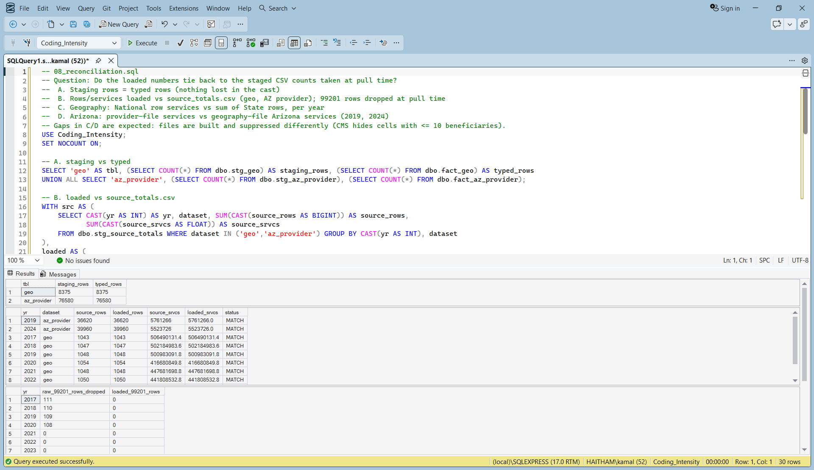

# E/M Coding Intensity Atlas

**How the mix of Medicare office-visit levels (99202-99205, 99211-99215) shifted from 2017 to 2024, nationally and in Arizona, and how Arizona specialties compare with each other.**

Coding intensity here means the share of visits billed at the two highest levels: 99214+99215 for established patients, 99204+99205 for new patients.

## 1. Business Problem & Executive Summary

Medicare pays more for higher office-visit levels. Payers, compliance teams and practices need to know how far coding has shifted toward the top levels, whether the 2021 office-visit rule change explains it, and how Arizona compares with the nation. This project answers that from public CMS data with SQL Server, Python and Power BI.

### Key findings

1. **High-level established visits rose every year but one, from 49.55% (2017) to 60.13% (2024).** That is +10.58 points. Only 2020 was flat (52.52% to 52.49%). Before the 2021 overhaul the climb was already about 1.5 points a year (2018: +1.48, 2019: +1.49). After it, 2021 was +2.45 and 2022-2024 ran +1.46 to +1.95. So the established-visit trend was not created by the overhaul. It sped up a little.
2. **The 2021 overhaul shows up in new-patient visits, not established ones.** 99204+99205 went from 48.77% (2020) to 55.87% (2021), +7.10 points in one year. Established visits moved +2.45 points over the same year. New-patient share kept rising to 62.35% in 2024. The rule change (visits leveled by medical decision making or time instead of history and exam) is the likely driver, but the data cannot say how much is the rule, how much is coding behavior, and how much is patient complexity.
3. **Arizona used to code well above the nation. That gap has mostly closed, and not because Arizona fell.** Established 99214+99215 share, Arizona vs national: 59.65% vs 52.52% in 2019 (+7.13 points), 62.09% vs 60.13% in 2024 (+1.96 points). Arizona ranked 1st of 52 states in each year 2017-2020 and 11th of 52 in 2024. Arizona's own share rose 2.45 points from 2019 to 2024, while the nation rose 7.61. In new-patient visits Arizona is at the national level in 2024 (62.78% vs 62.35%).

Smaller results, less exciting:
- Arizona specialty movers, established visits, 2019 to 2024 (AZ provider file only; specialties with 5,000+ established visits in both years): Psychiatry +17.7 points (59.8% to 77.5%), Radiation Oncology +15.1, Geriatric Medicine +14.5. Down: Dermatology -5.2 (23.5% to 18.3%) and Physician Assistant -5.1.
- Medicare payment per visit (service-weighted, office and facility together) went from $63.70 (2020) to $78.97 (2021) nationally, then roughly flat ($77.04 in 2024). The 2021 jump is mostly price: national average payment for 99214 went from $70.89 to $87.21. That this reflects the 2021 fee schedule changes is my interpretation, not something the data shows.
- Provider-level outliers (peer z-score beyond +/-2, Arizona, specialties with 10+ providers): 67 high and 218 low of 7,990 providers in 2019; 71 high and 212 low of 8,766 in 2024. These are counts only. They are variance, not evidence of anything.

## 2. Data Architecture & Relational Schema

CMS public use files (data.cms.gov) go through Python into SQL Server, then into Power BI. Details and URLs: [`data/README.md`](data/README.md). No data files are in this repo.

```
CMS CSV (geography 2017-2024; Arizona provider 2019, 2024)
  -> python/01_pull_cms.py (filter to 9 valid codes, drop NPI/names)
  -> stg_geo, stg_az_provider, stg_source_totals        (staging)
  -> fact_geo, fact_az_provider, dim_em_code             (typed tables)
  -> v_em_fact, v_specialty_benchmark, v_outlier_counts  (views)
  -> Power BI: FactEM, FactSpecialty, FactOutlier, DimEM, DimYear, DimSpecialty,
               _Measures (32 DAX measures)
```

CMS Medicare Physician & Other Practitioners public use files (data.cms.gov). Details and URLs in [`data/README.md`](data/README.md). No data files are in this repo.

| Dataset | Coverage |
|---|---|
| By Geography and Service | 2017-2024, national and state rows |
| By Provider and Service | Arizona only, 2019 and 2024 only |

- Medicare fee-for-service only (Part B). Medicare Advantage, Medicaid and commercial visits are not included.
- Newest year published in the CMS catalog when I pulled it (2026-10-09) is 2024.
- Codes kept: 99202-99205 and 99211-99215. 99201 (deleted in 2021) is dropped.
- No NPIs, names or addresses are stored. Provider rows carry only a sequential surrogate id that no query returns.

Tech stack: SQL Server Express (T-SQL, database `Coding_Intensity`), Python 3 with pandas, Power BI Desktop (DAX).

## 3. Key Business Metrics & SQL Proofs

Every query was run against the loaded database. Each row links the script to a screenshot of its output; text output is in [`sql/results/`](sql/results/). `schema_checks.sql` is a helper that lists tables, columns and row counts ([`schema_and_rowcounts.txt`](sql/results/schema_and_rowcounts.txt)).

| Query | What it answers | Proof (click to enlarge) |
|---|---|---|
| [`00_setup_database.sql`](sql/00_setup_database.sql) | Create database, staging and typed tables, views, load CSVs | [](sql/results/00_load_verification.png) |
| [`01_level_mix_by_specialty.sql`](sql/01_level_mix_by_specialty.sql) | Share of visits at each E/M level by Arizona specialty; national mix by code | [](sql/results/01_level_mix_by_specialty.png) |
| [`02_high_level_share.sql`](sql/02_high_level_share.sql) | 99214+99215 and 99204+99205 share by Arizona specialty (2019 vs 2024); states ranked | [](sql/results/02_high_level_share.png) |
| [`03_peer_percentile_zscore.sql`](sql/03_peer_percentile_zscore.sql) | Provider spread within a specialty: percentile, z-score, deciles (aggregates only) | [](sql/results/03_peer_percentile_zscore.png) |
| [`04_arizona_vs_national.sql`](sql/04_arizona_vs_national.sql) | Arizona vs national share and Arizona state rank by year | [](sql/results/04_arizona_vs_national.png) |
| [`05_year_over_year_shift.sql`](sql/05_year_over_year_shift.sql) | Mix by year around the 2021 overhaul; Arizona specialty movers 2019 to 2024 | [](sql/results/05_year_over_year_shift.png) |
| [`06_payment_per_visit.sql`](sql/06_payment_per_visit.sql) | Service-weighted Medicare payment per visit by code, year, Arizona vs national | [](sql/results/06_payment_per_visit.png) |
| [`07_outlier_counts_by_specialty.sql`](sql/07_outlier_counts_by_specialty.sql) | Counts of Arizona providers beyond +/-2 z-score by specialty (no identifiers) | [](sql/results/07_outlier_counts_by_specialty.png) |
| [`08_reconciliation.sql`](sql/08_reconciliation.sql) | Loaded rows and services tie to staged CSV counts; national vs sum of states | [](sql/results/08_reconciliation.png) |

**Python validation.** `python/02_validate.py` recounts rows and per-code services in the staged CSVs and compares them to the SQL tables for every year of both datasets. It also checks that only the 9 valid codes are loaded and that the Arizona provider file has no identity columns. Result in [`python/validation_output.txt`](python/validation_output.txt): **112 PASS / 0 FAIL of 112 checks.**

**DAX measures.** 32 measures with definition, purpose, BLANK behavior, test results and pitfalls: [`reports/dax-measures.md`](reports/dax-measures.md). Report themes: `reports/themes/`.

## 4. High-Resolution Dashboard Screenshots

Power BI, three pages, reads SQL Server directly. Full-size PNGs (2437 x 1367).

**1. National trend**


**2. Arizona vs national**


**3. Specialty deep dive**


## 5. How to Download and Run

**Just look at the dashboard:** download [`powerbi/coding-intensity-dashboard.pbix`](powerbi/coding-intensity-dashboard.pbix) (Download button on GitHub) and open it in Power BI Desktop. It reads SQL Server, so refresh only works after the steps below.

**Rebuild from source.** Requires SQL Server Express (`.\SQLEXPRESS`), Python 3 with pandas and requests, Power BI Desktop.

1. `python python/01_pull_cms.py` downloads the CMS geography files and writes CSVs to `C:\Users\Public\coding_intensity\` (SQL Server cannot read from Downloads). The Arizona provider files are multi-GB downloads: run `python python/01_pull_cms.py az` only if you need them.
2. Run `sql/00_setup_database.sql`, then `sql/01` to `sql/08` against `Coding_Intensity`.
3. `python python/02_validate.py` and check for `OVERALL: PASS`.
4. Open the .pbix and refresh.

## Limits

Full list with known vs assumed labels: [`reports/methodology-and-limits.md`](reports/methodology-and-limits.md).

- **No national or other-state specialty benchmarks.** Specialty and provider detail exist for Arizona only, and only for 2019 and 2024. Specialty movers compare two years, nothing in between.
- **Analysis is at specialty level.** Individual providers are never named or listed.
- **Outliers are statistical variance, not evidence of fraud or upcoding.** A high share can reflect patient mix, referrals, small volume or practice style. Shares are capped at 100%, so z-scores fire mostly on one side depending on the specialty.
- **Data vintage and scope.** Medicare fee-for-service only, newest year 2024. Results do not generalize to all patients.
- **2021 is a series break.** 99201 was deleted and leveling changed. 2020 to 2021 is a rule change plus behavior. Known: the rule changed. Assumed: how much of the rise is the rule.
- **CMS suppresses small cells** (10 or fewer beneficiaries). The Arizona provider file sums to about 2.5% (2019) and 2.9% (2024) fewer services than the geography file's Arizona rows. Suppression is the likely cause, not verified.
- **"Rank among 52 states" counts the District of Columbia and Puerto Rico as states.** The 52 are the 50 states plus DC and PR, limited to those with 50,000+ established visits in the year (Guam also qualifies in 2023, so 53 that year).
- **2020 is a pandemic year.** Volume fell sharply (about 17% in the geography file), so 2020 is a poor baseline.
- **Payment per visit mixes office and facility rates.**

### Project structure

```
coding-intensity-analytics/
├── README.md
├── .gitignore
├── data/
│   └── README.md                       # sources, years, staging path (no data files)
├── python/
│   ├── 01_pull_cms.py                  # download CMS files, write staged CSVs
│   ├── 02_validate.py                  # CSV vs SQL reconciliation (112 checks)
│   └── validation_output.txt
├── sql/
│   ├── 00_setup_database.sql
│   ├── 01_level_mix_by_specialty.sql
│   ├── 02_high_level_share.sql
│   ├── 03_peer_percentile_zscore.sql
│   ├── 04_arizona_vs_national.sql
│   ├── 05_year_over_year_shift.sql
│   ├── 06_payment_per_visit.sql
│   ├── 07_outlier_counts_by_specialty.sql
│   ├── 08_reconciliation.sql
│   ├── schema_checks.sql
│   └── results/                        # text output (and screenshots) per query
├── powerbi/
│   ├── coding-intensity-dashboard.pbix
│   └── screenshots/                    # 01_national_trend, 02_arizona_vs_national, 03_specialty_deep_dive
└── reports/
    ├── dax-measures.md
    ├── methodology-and-limits.md
    └── themes/                         # coding-theme-dark.json, coding-theme-light.json
```

### About

Built by **Haitham Saleh**, a licensed Medicare insurance agent moving into healthcare data analytics. Part of a portfolio applying Medicare domain knowledge to public data: SQL Server, Python, Power BI.
