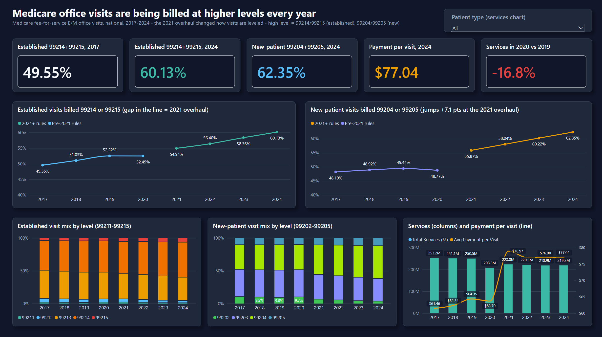
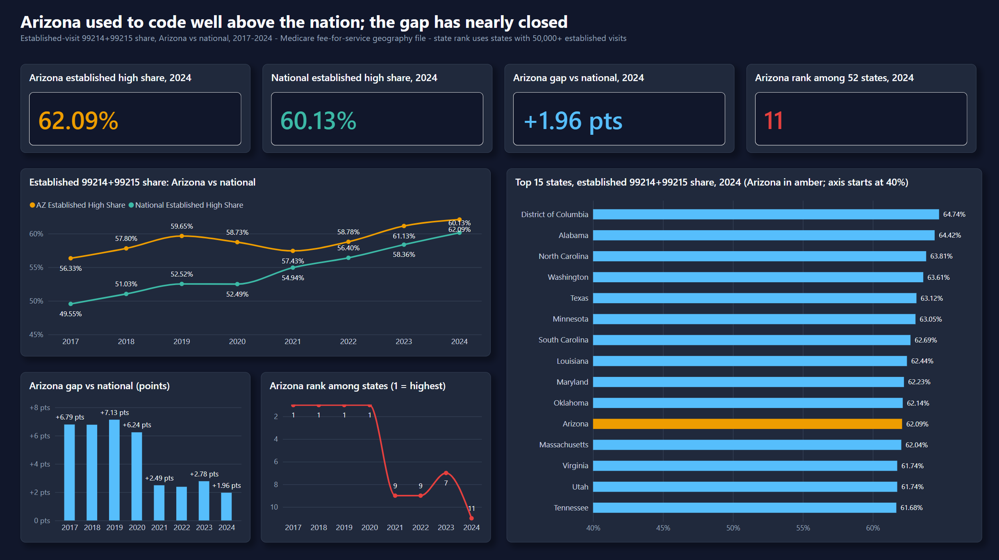
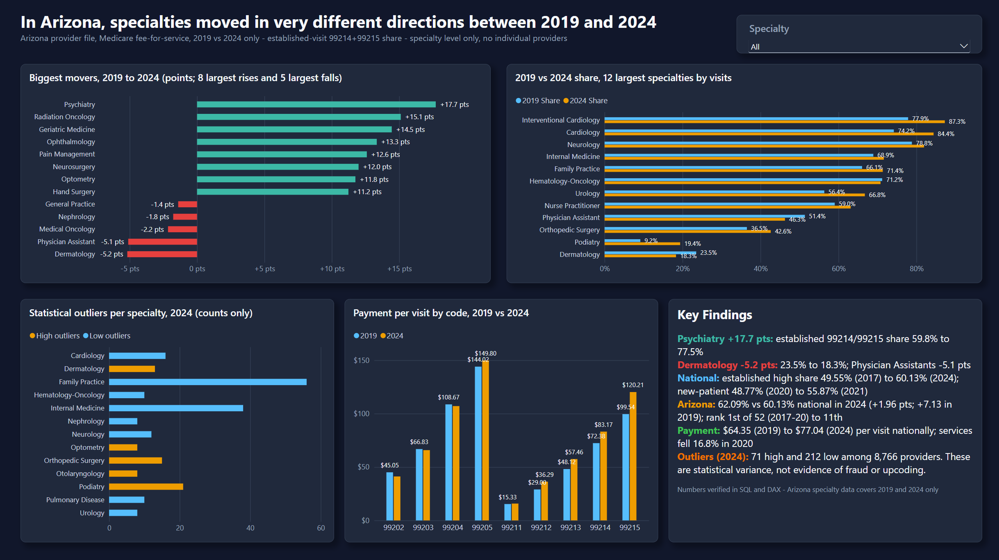

# E/M Coding Intensity Atlas

**How the mix of Medicare office-visit levels (99202-99205, 99211-99215) shifted from 2017 to 2024, nationally and in Arizona, and how Arizona specialties compare with each other.**

  

Coding intensity here means the share of visits billed at the two highest levels: 99214+99215 for established patients,
99204+99205 for new patients.

## 1. Executive Summary & Business Context

Medicare pays more for higher office-visit levels. Payers, compliance teams and practices need to know how far coding has
shifted toward the top levels, whether the 2021 office-visit rule change explains it, and how Arizona compares with the
nation. This project answers that from public CMS data with SQL Server, Python and Power BI.

Commercial relevance: E/M level mix drives physician revenue and payer spend, and is a standard lens for coding-compliance
review. Outliers here are statistical variance, not evidence of anything improper.

## 2. Data Architecture & Schema

CMS Medicare Physician & Other Practitioners public use files (data.cms.gov) go through Python into SQL Server, then into
Power BI. Sources and URLs: [`data/README.md`](data/README.md). No data files are in this repo.

```
CMS CSV (geography 2017-2024; Arizona provider 2019, 2024)
  -> python/01_pull_cms.py (filter to 9 valid codes, drop NPI/names)
  -> stg_geo, stg_az_provider, stg_source_totals        (staging)
  -> fact_geo, fact_az_provider, dim_em_code             (typed tables)
  -> v_em_fact, v_specialty_benchmark, v_outlier_counts  (views)
  -> Power BI: FactEM, FactSpecialty, FactOutlier, DimEM, DimYear, DimSpecialty,
               _Measures (32 DAX measures)
```

| Dataset | Coverage |
|---|---|
| By Geography and Service | 2017-2024, national and state rows |
| By Provider and Service | Arizona only, 2019 and 2024 only |

- Medicare fee-for-service only (Part B). Medicare Advantage, Medicaid and commercial visits are not included.
- Newest year published in the CMS catalog when pulled (2026-10-09) is 2024.
- Codes kept: 99202-99205 and 99211-99215. 99201 (deleted in 2021) is dropped.
- No NPIs, names or addresses are stored. Provider rows carry only a sequential surrogate id that no query returns.

Tech stack: SQL Server Express (T-SQL, database `Coding_Intensity`), Python 3 with pandas, Power BI Desktop (DAX).

## 3. Key Technical Implementations

### T-SQL ([`sql/`](sql/))

| Query | Technique / what it answers |
|---|---|
| [`00_setup_database.sql`](sql/00_setup_database.sql) | Database, staging and typed tables, views, CSV load |
| [`01_level_mix_by_specialty.sql`](sql/01_level_mix_by_specialty.sql) | Share of visits at each E/M level by Arizona specialty; national mix by code |
| [`02_high_level_share.sql`](sql/02_high_level_share.sql) | CTEs + `RANK()`: 99214+99215 and 99204+99205 share by specialty, states ranked |
| [`03_peer_percentile_zscore.sql`](sql/03_peer_percentile_zscore.sql) | Window functions `PERCENT_RANK`, `NTILE`, `STDEV`: percentile, z-score, deciles within specialty (aggregates only) |
| [`04_arizona_vs_national.sql`](sql/04_arizona_vs_national.sql) | CTEs + `RANK()`: Arizona vs national share and Arizona state rank by year |
| [`05_year_over_year_shift.sql`](sql/05_year_over_year_shift.sql) | CTEs: mix by year around the 2021 overhaul; specialty movers 2019 to 2024 |
| [`06_payment_per_visit.sql`](sql/06_payment_per_visit.sql) | Aggregation drill: service-weighted payment per visit by code, year, Arizona vs national |
| [`07_outlier_counts_by_specialty.sql`](sql/07_outlier_counts_by_specialty.sql) | CTEs + `ROW_NUMBER`/`STDEV` windows: counts beyond +/-2 z-score by specialty (no identifiers) |
| [`08_reconciliation.sql`](sql/08_reconciliation.sql) | Reconciliation: loaded rows and services tie to staged CSV counts; national vs sum of states |

[`schema_checks.sql`](sql/schema_checks.sql) is a helper that lists tables, columns and row counts.

### Python ([`python/`](python/))

- **ETL, `01_pull_cms.py`:** discovers file URLs from the CMS catalog (`requests`), downloads them, checks the header for
  required columns (raises if any are missing), filters with `pandas` to the 9 valid codes, drops identity columns, and
  writes staged CSVs and source totals.
- **Error validation, `02_validate.py`:** recounts rows and per-code services in the staged CSVs and compares them with the
  SQL tables for every year of both datasets; also checks that only the 9 valid codes are loaded and that the Arizona
  provider file has no identity columns. Result in [`validation_output.txt`](python/validation_output.txt):
  **112 PASS / 0 FAIL of 112 checks.**

### Power BI / DAX ([`reports/dax-measures.md`](reports/dax-measures.md))

32 measures with definition, purpose, BLANK behavior, test results and pitfalls, for example `Established 99214+99215 Share`,
`New 99204+99205 Share`, `AZ Gap vs National (pts)`, `AZ Rank`, `Avg Payment per Visit`, `Change 2019-2024 (pts)` and
`Outlier Count Total`. Every ratio measure follows the shared rules at the top of that file.

Page hierarchy: 1. National trend -> 2. Arizona vs national -> 3. Specialty deep dive.

## 4. Visuals / Deliverables

Power BI, three pages, reads SQL Server directly. Full-size PNGs (2437 x 1367).

**1. National trend**


**2. Arizona vs national**


**3. Specialty deep dive**


**SQL proof:** [`sql/results/`](sql/results/) holds a screenshot and text output per query, for example
[`08_reconciliation.png`](sql/results/08_reconciliation.png).

**Adding or refreshing exports:** save dashboard page captures into `powerbi/screenshots/` (or `docs/images/`, for example
`docs/images/dashboard_overview.png`), SQL captures into `sql/results/`, and reference them with ``.

Deliverable: [`powerbi/coding-intensity-dashboard.pbix`](powerbi/coding-intensity-dashboard.pbix). Methodology and limits:
[`reports/methodology-and-limits.md`](reports/methodology-and-limits.md).

## 5. Insights & Actionable Takeaways

1. **High-level established visits rose from 49.55% (2017) to 60.13% (2024), +10.58 points**, rising every year except
   2020. The climb was already about 1.5 points a year before the 2021 overhaul, so the overhaul sped it up rather than
   created it. *Action:* baseline against the pre-2021 trend before attributing growth to the rule change.
2. **The 2021 overhaul shows up in new-patient visits:** 99204+99205 jumped from 48.77% to 55.87% (+7.10 points) in one
   year, versus +2.45 for established visits, and reached 62.35% by 2024. The data cannot say how much is the rule, coding
   behavior, or patient complexity.
3. **Arizona's lead over the nation has mostly closed.** Established high-level share, Arizona vs national: 59.65% vs
   52.52% in 2019 (+7.13 points), 62.09% vs 60.13% in 2024 (+1.96). Arizona ranked 1st of 52 in 2017-2020 and 11th in 2024.
   Arizona rose 2.45 points over 2019-2024 while the nation rose 7.61.
4. **Specialty movers in Arizona (2019 to 2024, established visits):** Psychiatry +17.7 points (59.8% to 77.5%),
   Radiation Oncology +15.1, Geriatric Medicine +14.5; Dermatology fell 5.2 points. National Medicare payment per visit
   rose from $63.70 (2020) to $78.97 (2021), mostly price (99214 average payment $70.89 to $87.21).
   *Action:* review specialty-level mix first, not individual providers.

## 6. Setup & Reproduction Guide

**Requirements:** Python 3 with `pandas` and `requests`, SQL Server Express (`.\SQLEXPRESS`), Power BI Desktop (Windows).

1. **Clone:** `git clone https://github.com/Haitham1111/coding-intensity-analytics.git`
2. **Install Python packages:** `pip install pandas requests`
3. **Pull the data:** `python python/01_pull_cms.py` downloads the CMS geography files and writes CSVs to
   `C:\Users\Public\coding_intensity\` (SQL Server cannot read from Downloads). The Arizona provider files are multi-GB
   downloads: run `python python/01_pull_cms.py az` only if you need them.
4. **Build and query the database:** run `sql/00_setup_database.sql`, then `sql/01` to `sql/08` against `Coding_Intensity`.
5. **Validate:** `python python/02_validate.py` and check for `OVERALL: PASS`.
6. **Dashboard:** open the `.pbix` in Power BI Desktop and click *Refresh*. Refresh only works after the steps above.

## Limits

Full list with known vs assumed labels: [`reports/methodology-and-limits.md`](reports/methodology-and-limits.md).

- **No national or other-state specialty benchmarks.** Specialty and provider detail exist for Arizona only, for 2019 and 2024.
- **Analysis is at specialty level.** Individual providers are never named or listed.
- **Outliers are statistical variance, not evidence of fraud or upcoding.** A high share can reflect patient mix, referrals,
  small volume or practice style.
- **Data vintage and scope.** Medicare fee-for-service only, newest year 2024.
- **2021 is a series break** (99201 deleted, leveling changed), and **2020 is a pandemic year** (volume down about 17%).
- **CMS suppresses small cells** (10 or fewer beneficiaries); suppression is the likely, unverified cause of the ~2.5-2.9%
  gap between the Arizona provider file and the geography file.
- **"Rank among 52 states" counts DC and Puerto Rico** and requires 50,000+ established visits in the year.
- **Payment per visit mixes office and facility rates.**

## Author

Built by **Haitham Saleh**, a licensed Medicare insurance agent moving into healthcare data analytics.
LinkedIn: https://www.linkedin.com/in/haitham-saleh-8a1a12206 | GitHub: https://github.com/Haitham1111
